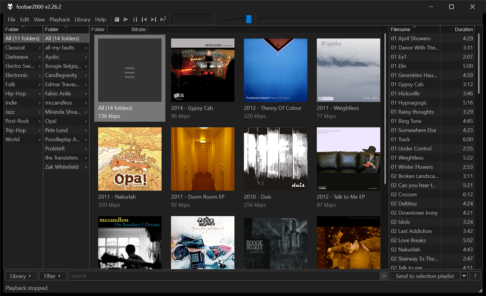

# Facet Browser for foobar2000

**Version 1.0.0** · Created by **Faris Aljanubi** · Licence: [GPL-3.0](LICENSE) · **[Documentation](https://faljanubi.github.io/facet-browser/)**



<sub>Music in the screenshot: Creative Commons albums from the Internet Archive ([credits](docs/screenshots/CREDITS.md)).</sub>

A media library browser for foobar2000 2.x that works like *Facets* by Frank Bicking
(2007–2011). Facets was only ever released for 32-bit foobar2000 and predates the dark mode.
Facet Browser runs natively in **64-bit foobar2000** and follows foobar2000's **dark mode**
and colour scheme. It is an independent reimplementation and contains no code from Facets.

## Features (as in Facets)

- **Linked panes.** Selecting items in one pane filters the panes to its right.
  Multi-select with Ctrl / Shift. Each pane has an optional **summary item**, e.g. "All (99 folders)".
- **Folder column.** Each pane that uses *Folder* shows the next folder level below the
  previous one, starting at your Media Library folder. Folders that contain more folders are
  marked with ›. Example: *Folder › Folder › Folder › Filename*.
- **Columns** (right-click a pane header › *Columns*): Genre, Album artist, Artist, Date, Album,
  Track, Title, Filename, Filename.ext, Folder, or *Multiple columns* side by side. Column
  definitions are title formatting, edited in *Preferences › Media Library › Facet Browser*.
  `%<field>%` gives one entry per value of a multi-value tag.
- **Statistics** (header › *Statistics*): Bitrate, Duration, File created, First/Last added,
  First/Last played, First/Last release, Index, Items, Last modified, Lossless ratio, Played,
  Played duration, Rating, Subitems, Total peak, Total size. Click a header to sort by it.
- **Sort by** (header › *Sort by*): sort a pane by any of its columns or by any statistic, even
  one that is not displayed, ascending or descending.
- **Display** (header › *Display*): Columns, or Album art with bottom labels, right labels or
  no labels; summary item on/off; Front, Back, Disc or Artist art.
- **Toolbar** (bottom or top): **Source** (Library, Playlist, Automatic), **Filter** (your saved
  queries, optionally several at once), **Search** with history, the **action** button with
  its menu, and **?** for query syntax help.
- **Actions** (toolbar button, double-click, Enter, right-click): Send to selection playlist,
  keep playing playlist · Send to selection playlist · Send to current playlist · Send to new
  playlist · Send to new autoplaylist · Add to selection playlist · Add to current playlist.
- Right-click items for the actions above, the standard foobar2000 track menu, **selection logic**
  (OR / AND) and the **Pane** menu (insert, append, remove, cut, copy, paste).
- Drag items into any playlist; drag the gaps between panes to resize them.

## Requirements

- **foobar2000 2.x** for Windows, 64-bit or 32-bit (one component file contains both)
- Windows 10 or 11

## Install

1. Download `foo_facet_browser.fb2k-component` from the
   **[Releases page](https://github.com/faljanubi/facet-browser/releases/latest)** (or build it, see below).
2. Double-click it, or in foobar2000 open *File › Preferences › Components*, click
   **Install...**, pick the file, then click **Apply** and let foobar2000 restart.
3. Use it:
   - **As a window:** *View › Facet Browser*
   - **In your layout (Default UI):** *View › Layout › Enable layout editing mode*, right-click
     a panel › *Replace UI Element...* › **Facet Browser** (under *Media Library Viewers*)

## Build

Requirements: Windows 10/11 and **Visual Studio 2022** or **Build Tools for Visual Studio 2022**
with the *Desktop development with C++* workload (MSVC v143 + Windows SDK).
The foobar2000 SDK (2026-10-01) and WTL 10 are included in `third_party/`.

```bat
build.cmd
```

This builds Release x64 and x86 and writes `dist\foo_facet_browser.fb2k-component`.
You can also open `foo_facet_browser.sln` in Visual Studio.

## Source layout

```
src/
  main.cpp       component registration and About text
  config.*       per-panel settings (panes, statistics, display, toolbar)
  globals.*      shared column/filter definitions, selection playlist, search history
  prefs.cpp      Preferences page (Media Library > Facet Browser)
  model.*        evaluates columns once per track; folder levels, grouping, statistics, AND/OR filtering
  browser.*      the UI element: panes, search, presets, actions, context menu, layout
  artgrid.*      album art pane (custom-drawn grid, background cover loading via WIC)
  foo_facet_browser.rc   dialog + version resource
third_party/
  foobar2000_sdk/   foobar2000 SDK 2026-10-01 (BSD-style licence, see sdk-license.txt)
  wtl/              Windows Template Library 10 (MS-PL, see MS-PL.txt)
```

## Problems and ideas

Please open an [issue](https://github.com/faljanubi/facet-browser/issues) and include your foobar2000 version
(*Help › About*), whether it's 64-bit or 32-bit, and the Facet Browser version
(*Preferences › Components*).

## Licences

- Facet Browser: © 2026 Faris Aljanubi. Free software under the [GNU General Public License version 3](LICENSE)
  or (at your option) any later version, with **no warranty**. It also has an extra permission
  ([EXCEPTION.txt](EXCEPTION.txt)) that allows combining it with the foobar2000 SDK, WTL and foobar2000.
- foobar2000 SDK © Peter Pawlowski, see `third_party/foobar2000_sdk/sdk-license.txt`
  (pfc and libPPUI have their own licence files in their folders).
- WTL © Microsoft Corporation / WTL Team, Microsoft Public License, see `third_party/wtl/MS-PL.txt`.

Not affiliated with foobar2000 or with the authors of Facets.
